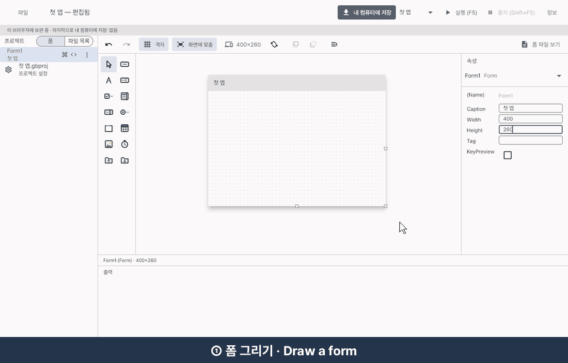
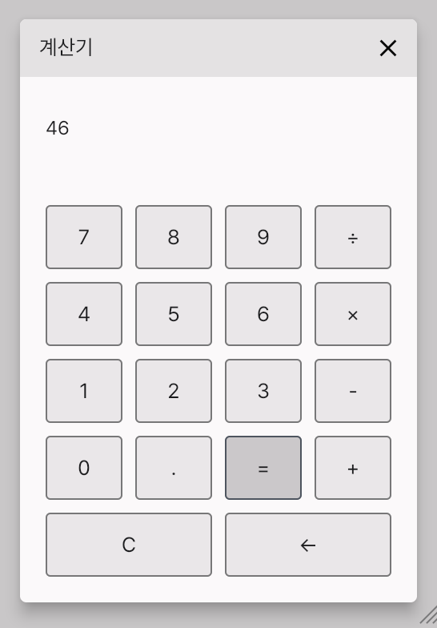
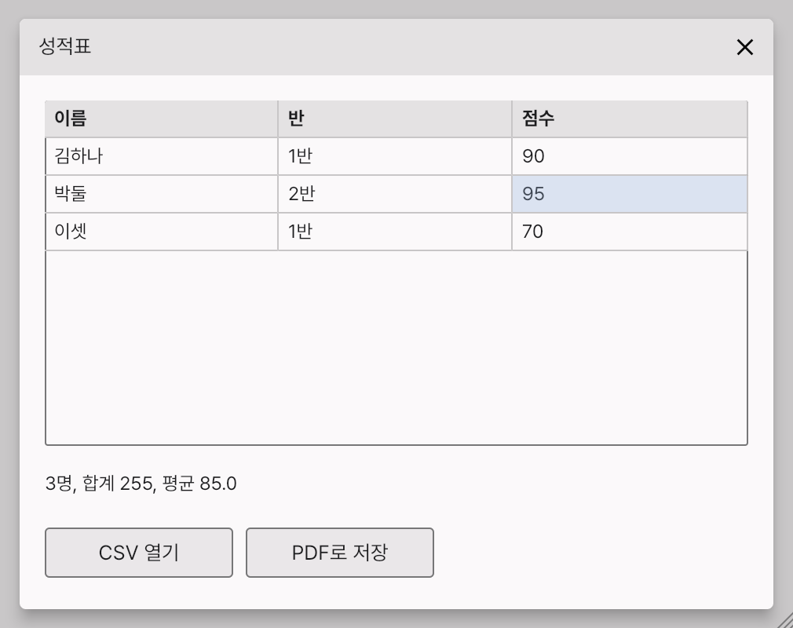

# GuBASIC

**A Visual Basic–style RAD tool, built with Flutter™.**

### ▶ [Open the web IDE](https://kooboom.github.io/gubasic/ide/) — nothing to install, right in your browser



Draw a form → double-click a control → write a few lines of BASIC → press F5. Then export it as a web, Windows or macOS app. New here? [Make your first app in five minutes](docs/FIRST_APP.md).

[한국어](README.ko.md)

## Who it is for

- **Hobbyists** making their first apps, who want to see a window and a button work before learning a toolkit.
- **People who miss Visual Basic** and its draw → double-click → write → run way of working.
- **People at work, teachers among them,** who want to build their own programs to take the repetitive part out of their work.

## Examples

| Calculator: ten digit buttons in one handler | Scores: a CSV list in a Grid, its total and average, saved as PDF |
|---|---|
|  |  |

Both are in the IDE's examples, next to hello, quiz, typing and askname.

> **Status: stage 3, v0.4 "For work" complete** ([v0.4.0](https://github.com/kooboom/gubasic/releases/tag/v0.4.0), a development build).
>
> - **What you can do now:** draw forms with buttons, labels, text boxes, lists, grids, menus and more; write event handlers in an editor that colours, completes and explains; run with F5; keep projects in the browser or as folders; export web, Windows and macOS apps. For work: open and save dialogs, text and CSV files, dates and `Format`, the `Grid` control and PDF files.
> - **Also:** the IDE as an app for macOS and Windows ([apps/ide](apps/ide)), and the [playground](https://kooboom.github.io/gubasic), the language on its own.
> - **Known limits:** the macOS and Windows apps are unsigned development builds; phone apps (stage 3) and the debugger (v0.5) come later. The full list: [docs/KNOWN_ISSUES.md](docs/KNOWN_ISSUES.md). What comes next: [ROADMAP](docs/ROADMAP.md).
>
> GuBASIC is a personal hobby project, so answers to issues and questions may be slow.

---

## Why

Classic Visual Basic had a workflow nobody has really replaced:

1. Drag a button onto a form.
2. Set its caption in the Properties window.
3. Double-click it.
4. Write `Label1.Caption = "Hello"` inside `Command1_Click`.
5. Press F5.

Modern cross-platform toolkits are far more powerful, but that *draw → double-click → write → run* loop is gone. GuBASIC brings it back, on a Mac first, and uses Flutter underneath so the same project can be released on every major platform.

GuBASIC is also a deliberately fun project: it is a language, an interpreter, a transpiler and an IDE built by one person for the joy of building tools that build things.

## How it works (in one picture)

```
 ┌───────────────────────── GuBASIC IDE (Flutter desktop app) ─────────────────────────┐
 │  Form designer  →  form.yaml          Code editor  →  .gbas (BASIC)                 │
 │                          │                                │                          │
 │                          └──────────────┬─────────────────┘                          │
 │                                   parser → AST                                       │
 │                          ┌──────────────┴─────────────────┐                          │
 │                   Interpreter (F5)                 Transpiler (Build)                │
 │                runs instantly inside              generates a Flutter project        │
 │                     the IDE                       → macOS / Windows / iOS /          │
 │                                                     Android / Web                    │
 └──────────────────────────────────────────────────────────────────────────────────────┘
```

- **While developing**, press F5: the interpreter runs your app inside the IDE immediately. No Flutter installation needed.
- **When releasing**, the transpiler turns your BASIC into Dart and builds a native app with Flutter.

## A taste of the language

```vb
Dim clickCount As Integer

Sub Form_Load()
    lblMessage.Caption = "Press the button"
End Sub

Sub btnHello_Click()
    clickCount = clickCount + 1
    Dim name = InputBox("What is your name?")
    MsgBox("Hello, " & name & "! (" & clickCount & ")")
End Sub
```

No `await`, no widgets, no build context. Just events and code, the way it used to be. The same program, with its form, is in [examples/hello](examples/hello).

## Documents

| Document | What it covers |
|---|---|
| [docs/DESIGN.md](docs/DESIGN.md) | Architecture and every design decision, with the reasons |
| [docs/LANGUAGE.md](docs/LANGUAGE.md) | Draft specification of the GuBASIC language |
| [docs/ROADMAP.md](docs/ROADMAP.md) | Stages, milestones and what 1.0 will *not* do |
| [docs/KNOWN_ISSUES.md](docs/KNOWN_ISSUES.md) | Problems deliberately left unfixed for now, and when they will be revisited |
| [CLAUDE.md](CLAUDE.md) | Rules for AI coding assistants working on this repo |

## Platforms

| | Develop on | Release to |
|---|---|---|
| macOS | ✅ (primary) | ✅ |
| Windows | ✅ | ✅ |
| iOS | — | ✅ (requires a Mac, Xcode and an Apple Developer account) |
| Android | — | ✅ |
| Web | — | ✅ |

## How GuBASIC is built

GuBASIC is designed and directed by **Jungmo Gu**. AI coding assistants (Claude) help draft documents and code; every change is reviewed by the author. AI-assisted commits carry a `Co-Authored-By` line, so the history shows exactly where AI was involved.

Building a language and an IDE together with an AI is part of the fun of this project, and part of what it records.

## License

MIT — see [LICENSE](LICENSE). © 2026 Jungmo Gu

The apps you make with GuBASIC are yours: their forms and code belong to whoever wrote them, under any license they choose. An exported app carries GuBASIC's player and the fonts and packages it uses, whose notices go with it.

## Trademarks and affiliation

GuBASIC is an independent personal project. It is **not affiliated with, endorsed by, or sponsored by Microsoft or Google**.

- Visual Basic is a trademark of Microsoft Corporation. "Visual Basic–style" describes the programming workflow GuBASIC is inspired by.
- Flutter and the related logo are trademarks of Google LLC. GuBASIC is built with the Flutter SDK.
