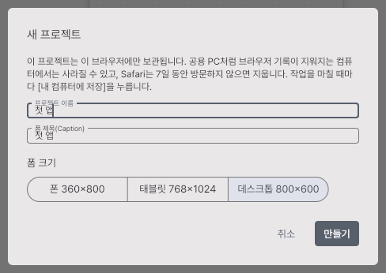
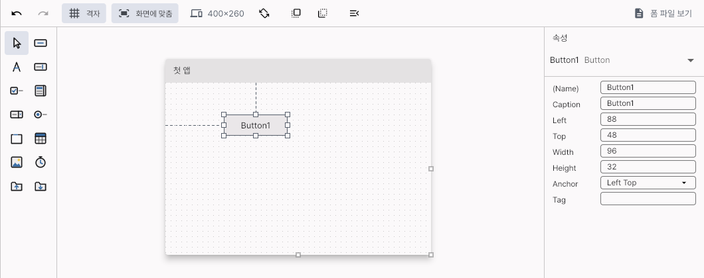
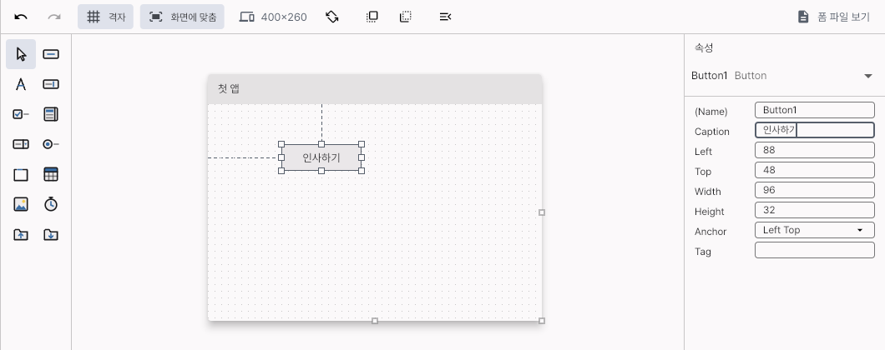
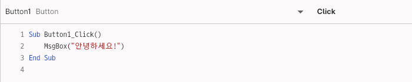
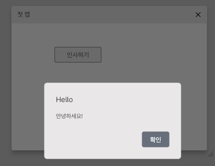
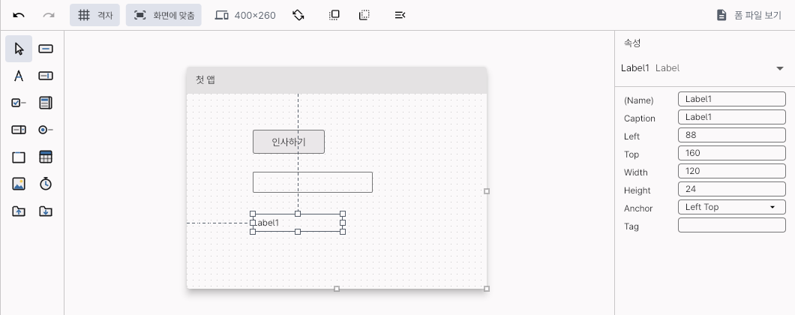
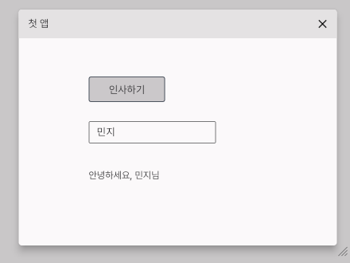

# 5분 만에 첫 앱 만들기

웹 IDE에서 버튼 하나를 누르면 인사하는 앱을 만들어 실행해 봅니다. 설치할 것은 없고, 컴퓨터의 브라우저만 있으면 됩니다.

[English](FIRST_APP.md)

## 1. 웹 IDE 열기

https://kooboom.github.io/gubasic/ide/ 를 엽니다. 처음에는 예제 hello가 열려 있습니다.

## 2. 새 프로젝트

위쪽의 **파일 → 새 프로젝트…**를 누릅니다. 프로젝트 이름에 `첫 앱`을 쓰면 폼 제목도 같이 `첫 앱`이 됩니다. 폼 크기는 **데스크톱 800×600**을 그대로 두고 **만들기**를 누릅니다.



프로젝트는 이 브라우저에 보관됩니다. 작업을 마치면 **내 컴퓨터에 저장**을 눌러 `.zip`으로 받아 두세요.

폼을 조금 작게 쓰고 싶으면 오른쪽 속성 창에서 `Width`를 `400`, `Height`를 `260`으로 바꾸고 Enter를 누릅니다(이 안내의 그림이 그 크기입니다).

## 3. 버튼 그리기

왼쪽 도구 상자의 두 번째 아이콘이 버튼입니다(마우스를 올리면 `Button`이라고 나옵니다). 그것을 폼 위로 끌어다 놓습니다. 아이콘을 두 번 눌러도 폼 가운데에 놓입니다.



## 4. 버튼의 글자 바꾸기

버튼이 골라진 채로, 속성 창의 `Caption`을 `인사하기`로 바꾸고 Enter를 누릅니다.



## 5. 코드 쓰기

폼 위의 버튼을 **더블클릭**합니다. 코드 편집기가 열리고 `Sub Button1_Click()`과 `End Sub`가 생깁니다. 그 사이에 한 줄을 씁니다.

```vb
Sub Button1_Click()
    MsgBox("안녕하세요!")
End Sub
```



## 6. 실행하기

**F5**를 누릅니다(위쪽의 **실행** 버튼도 됩니다). 실행 창에 폼이 뜨면 **인사하기** 버튼을 누릅니다.



**확인**을 누르고, **중지**(Shift+F5)나 창의 ✕로 끝냅니다. 이것으로 첫 앱이 완성됐습니다.

## 7. 더 해 보기: 이름을 받아 인사하기

1. 왼쪽 프로젝트 목록의 Form1 줄에서 **디자인 보기** 아이콘을 눌러 폼으로 돌아갑니다.
2. 도구 상자에서 텍스트 상자(`TextBox`, 오른쪽 두 번째 줄)와 레이블(`Label`, 글자 A)을 폼에 끌어다 놓습니다.

   

3. 버튼을 다시 더블클릭하고, `MsgBox` 줄을 이렇게 바꿉니다.

   ```vb
   Label1.Caption = "안녕하세요, " & TextBox1.Text & "님"
   ```

4. F5를 누르고, 텍스트 상자에 이름을 쓴 뒤 버튼을 누릅니다.

   

## 다음에 해 볼 것

- **예제:** 위쪽의 목록에서 calculator(계산기), scores(성적표), quiz 같은 예제를 열고 F5로 실행해 봅니다. 코드를 바꿔 봐도 원본은 그대로입니다.
- **앱으로 내보내기:** **파일 → 웹 앱으로 내보내기…**로 웹에 올릴 수 있는 앱을, **Windows 앱으로 내보내기…**로 Windows 앱을 만듭니다.
- **코드가 하는 일 들여다보기:** 줄 왼쪽의 여백을 누르면 중단점(빨간 점)이 생깁니다. F5를 누르고 버튼을 누르면 프로그램이 그 줄에서 멈추고, 코드 아래에 변수가 보입니다. F8은 한 문장씩 실행하고 F5는 계속 갑니다. 변수 아래의 직접 실행 칸에 `? clickCount + 1`을 쓰면 식의 값이 나옵니다.
- **언어 설명:** [docs/LANGUAGE.ko.md](LANGUAGE.ko.md)
- 막히는 곳이 있으면 [이슈](https://github.com/kooboom/gubasic/issues/new/choose)로 알려 주세요. 개인 취미 프로젝트라 답이 늦을 수 있습니다.
