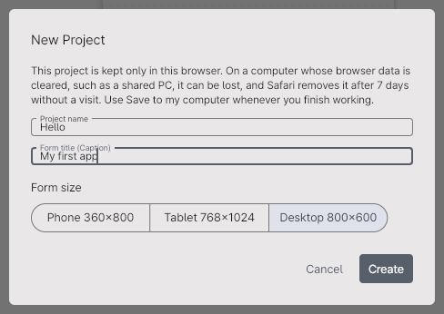
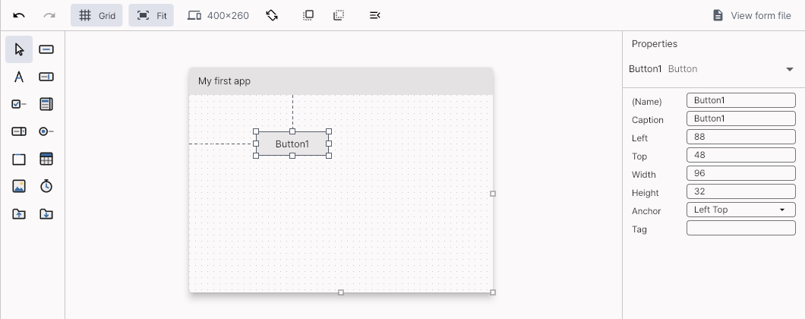
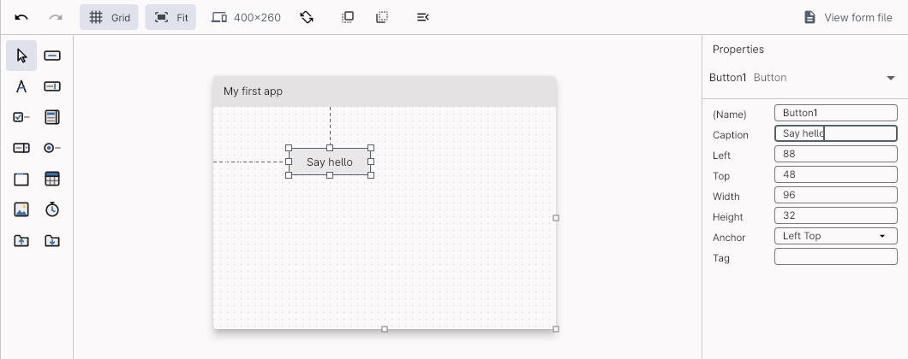
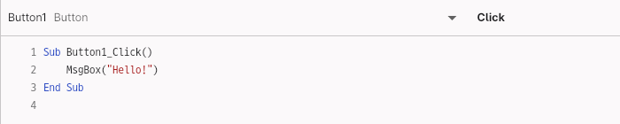
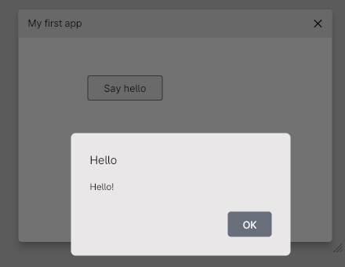
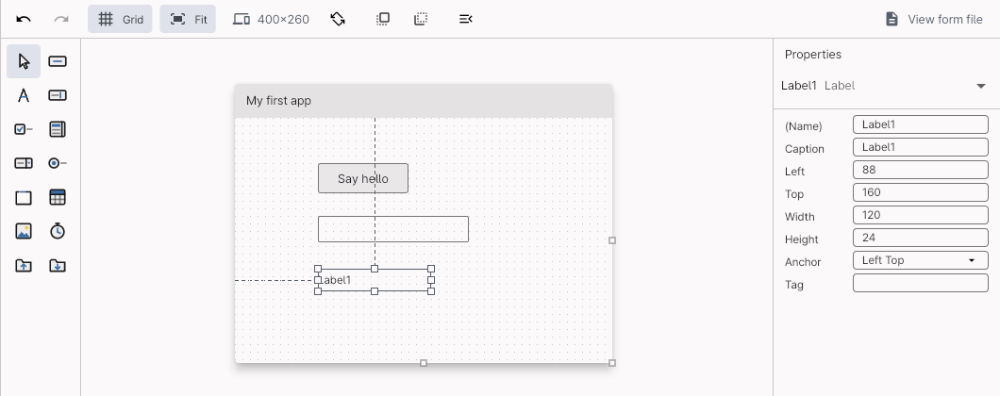
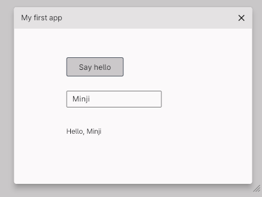

# Your first app in five minutes

Make an app in the web IDE that says hello when you click a button, and run it. There is nothing to install: a browser on a computer is all it takes.

[한국어](FIRST_APP.ko.md)

## 1. Open the web IDE

Open https://kooboom.github.io/gubasic/ide/. The hello example is open at first.

## 2. A new project

Click **File → New Project…** at the top. Type `Hello` as the project's name and `My first app` as the form's title, leave the form size at **Desktop 800×600**, and click **Create**.



The project is kept in this browser. When you finish, click **Save to my computer** to keep it as a `.zip`.

If you would like a smaller form, set `Width` to `400` and `Height` to `260` in the Properties window on the right, pressing Enter after each (the pictures here are of that size).

## 3. Draw a button

The second icon of the toolbox on the left is the button (hover over it and it says `Button`). Drag it onto the form. Clicking the icon twice puts one in the middle of the form too.



## 4. Change the button's text

With the button chosen, set `Caption` in the Properties window to `Say hello` and press Enter.



## 5. Write the code

**Double-click** the button on the form. The code editor opens with `Sub Button1_Click()` and `End Sub`. Write one line between them.

```vb
Sub Button1_Click()
    MsgBox("Hello!")
End Sub
```



## 6. Run it

Press **F5** (or the **Run** button at the top). When the form shows in the run window, click **Say hello**.



Click **OK**, then stop it with **Stop** (Shift+F5) or the window's ✕. That is your first app.

## 7. More: say hello by name

1. Click the **View Design** icon on Form1's line in the project list on the left to go back to the form.
2. Drag a text box (`TextBox`, second row, right) and a label (`Label`, the letter A) from the toolbox onto the form.

   

3. Double-click the button again, and change the `MsgBox` line to this:

   ```vb
   Label1.Caption = "Hello, " & TextBox1.Text
   ```

4. Press F5, type a name into the text box, and click the button.

   

## What to try next

- **Examples:** open calculator, scores, quiz and the others from the list at the top, and run them with F5. Change their code freely: the originals stay as they are.
- **Export an app:** **File → Export as Web App…** makes an app you can put on the web, **Export as Windows App…** a Windows app.
- **Find out what the code does:** click in the gutter left of a line to set a breakpoint (a red dot), press F5 and click the button: the program pauses on that line, the variables show below the code, F8 runs one statement at a time and F5 goes on. In the Immediate field below the variables, `? clickCount + 1` shows the value of an expression.
- **The language:** [docs/LANGUAGE.md](LANGUAGE.md)
- If you get stuck, tell us in an [issue](https://github.com/kooboom/gubasic/issues/new/choose). GuBASIC is a personal hobby project, so answers may be slow.
